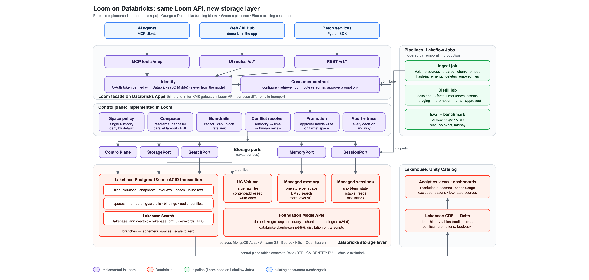

# Loom on Databricks: storage-layer demo

Loom API stays. Only Loom's **storage layer** moves to Databricks. A thin Loom facade (this repo) exposes
the consumer contract and reaches storage only through **ports** (`Loom/ports.py`); only Databricks
adapters exist. All data is synthetic.

- Discovery, doc links, deviations: [`docs/discovery.md`](docs/discovery.md)
- Every number we quote: [`docs/measurements.md`](docs/measurements.md), [`bench/results.md`](bench/results.md)
- 30-minute talk track: [`docs/demo_script.md`](docs/demo_script.md)
- Memory options and the Option B decision: [`docs/memory-options.md`](docs/memory-options.md), [`docs/design-memory-option-b.md`](docs/design-memory-option-b.md)

## Architecture



Retrieve request flow: [`docs/retrieve_flow.svg`](docs/retrieve_flow.svg) (also in the app's **Architecture** tab).

## What is Databricks and what is Loom

| Capability | Provided by | Docs |
|---|---|---|
| Files, versions, snapshots, overlays, leases, inline text, one ACID transaction | **Lakebase** (Postgres 18) | [Lakebase](https://docs.databricks.com/aws/en/oltp/projects/) |
| Large raw files, content-addressed, write-once | **UC Volume** (`loom_catalog.loom.raw`) | [Volume privileges](https://docs.databricks.com/aws/en/volumes/privileges) |
| Hybrid retrieval over pooled KBs (ANN + BM25) | **Lakebase Search** (`lakebase_vector`, `lakebase_text`) | [Lakebase Search](https://docs.databricks.com/aws/en/oltp/projects/lakebase-search) |
| Short-term conversation state | **Managed agent sessions** (Beta) | [Sessions](https://docs.databricks.com/aws/en/agents/agent-memory/managed-sessions) |
| Long-term memory, one store per space | **Managed agent memory** (Beta) | [Memory](https://docs.databricks.com/aws/en/agents/agent-memory/managed-memory) |
| Ephemeral spaces | **Lakebase branches** | [Branches](https://docs.databricks.com/aws/en/oltp/projects/manage-branches) |
| Audit / feedback / traces to the lakehouse | **Lakebase Change Data Feed** (Public Preview) → Delta | [Lakebase CDF](https://docs.databricks.com/aws/en/oltp/projects/lakebase-cdf) |
| Embeddings, distillation LLM | **Foundation Model APIs** (`databricks-gte-large-en`, `databricks-claude-sonnet-5-5`) | [Models](https://docs.databricks.com/aws/en/machine-learning/foundation-model-apis/supported-models) |
| Facade + MCP hosting | **Databricks Apps** | [Custom MCP on Apps](https://docs.databricks.com/aws/en/agents/mcp-tools/custom-mcp) |
| Spaces, composition, policy, guardrails, conflict resolution, promotion, audit records | **Implemented in Loom** (`Loom/spaces`, `Loom/control`) | — |
| Ingest (hash/incremental), distillation, evaluation | **Implemented in the pipeline** (`pipelines/`) | — |

## Layout

```
Loom/contract.py        configure / retrieve / contribute models (the consumer contract)
Loom/service.py         the one implementation; REST (api.py), MCP (mcp_server.py), SDK (sdk.py) call it
Loom/ports.py           StoragePort, SearchPort, MemoryPort, SessionPort, ControlPlanePort (swap surface)
Loom/spaces/            model, registry, policy (single authority for access decisions)
Loom/control/           composer, conflict, guardrails, audit, promotion, fusion (RRF)
Loom/adapters/databricks/  lakebase_store, volume_store, search_lakebase, memory, sessions, embeddings
pipelines/              ingest_job, distill_job, eval_job, ingest_core
app/                    Databricks App: facade + MCP + web UI     resources/  bundle jobs + app
sql/                    schema, rls, indexes, analytics           scripts/    setup, seed, demos, preflight
bench/benchmark.py      recall/latency, selective-filter test     tests/      unit, parity, live (LOOM_LIVE=1)
```

## Run it (in order)

```bash
uv sync                                   # Python 3.12, databricks-sdk 0.149
./scripts/setup.sh                        # UC schema/volume, groups, persona SPs + secrets, Lakebase project
#   -> first run stops: enable Lakebase Search in the UI (one-way, restarts computes), then:
./scripts/setup.sh                        # extensions, schema, RLS roles, Postgres group roles, CDF -> Delta
uv run python scripts/seed.py             # spaces via configure, corpus via ingest, facts via contribute,
                                          # search indexes, synthetic transcripts in managed sessions
databricks bundle deploy                  # jobs (ingest, distill, bench, eval) + app
uv run python scripts/app_grants.py       # app SP: Lakebase, endpoints, secrets, stores, volume; persona CAN_USE
databricks bundle run loom_app            # start the app
uv run python scripts/preflight.py        # PASS/FAIL checklist (12 checks)
uv run pytest -q                          # unit + contract parity (no cloud)
LOOM_LIVE=1 uv run pytest -q tests/live   # live acceptance against the workspace
```

Demos: `scripts/demo_runner.py` (web/MCP/SDK parity on the app), `scripts/service_client_demo.py`,
`scripts/freshness_demo.py`, `scripts/distill_demo.py`, `scripts/ephemeral_demo.py`,
`scripts/cdf_latency.py`, `scripts/analytics_report.py`, `bench/benchmark.py`.
Teardown: `./scripts/teardown.sh` (asks for confirmation; deletes project, stores, schema, SPs, groups, scope, app, jobs).

## Design notes

- **Composition at read time** (`Loom/control/composer.py`): identity comes from a verified token (on Apps,
  `X-Forwarded-Access-Token` set by the platform proxy, verified with SCIM `/Me`). Candidate spaces are own personal,
  project/team (narrowed by hints) and company. Each is authorized by `spaces/policy.py`, then fanned out in
  parallel to the space's own backends, read guardrails are applied per space in fused order, results are merged
  with RRF and conflicts resolved. A composition trace and audit rows are written. Nothing is copied between spaces.
- **Memory**: one managed memory store per space (`loom-{scope}-{key}`). Search there is BM25-only; semantic
  recall comes from Lakebase Search over KB files (distilled lessons are KB markdown). `actor_id` is set by Loom
  (the user for personal stores, a shared actor for shared stores) and is not treated as a security boundary.
- **Transactional writes**: large payloads go to the Volume first (content-addressed, write-once), then metadata
  rows commit in one Lakebase transaction. A failure leaves only an unreferenced blob (GC-able), never partial
  metadata (`tests/live/test_storage_live.py`).
- **Defense in depth**: chunk rows carry access principal tags; Postgres RLS applies under NOLOGIN roles
  `loom_reader` / `loom_writer` because the project owner role has BYPASSRLS. UC volume access is via grants.
- **Promotion**: contributions or distilled lessons reach a higher scope only after an approver with write on
  the target approves (the proposer cannot). Distilled output lands in a staging space first.

## Known limits (stated plainly)

- Managed memory search is **BM25 only** (no vector similarity, top-N ≤ 100) and access control is **store-level only**;
  `actor_id` partitions but is not a security boundary. Managed memory and sessions are **Beta**.
- **No DENY in Unity Catalog**: access is shown through grants only. In this workspace the `loom-*` groups are
  workspace-local, which UC does not accept, so volume grants go to each persona service principal.
- **Composition and policy are application-layer** (Loom). Storage RLS is defense in depth against facade query bugs,
  not against a compromised facade.
- **Single primary**: one read-write compute per Lakebase branch (write ceiling = that compute; scale with CU,
  read replicas for reads).
- **Enabling Lakebase Search is one-way** and restarts computes; it is a UI action (no API flag found).
- **BM25 corpus statistics are computed at index build time**; new chunks are searchable immediately but scores
  drift until `REINDEX` (measured 0.35 s at ~960 chunks).
- **Limits** (documented): 500 branches/project, 500 databases/branch, 20 active computes, 1000 projects/workspace,
  branch TTL ≤ 30 days, scale-to-zero timeout 60 s–7 days. Managed memory store limits are not documented.
- **No standalone hosted reranker** for Lakebase Search results (the Databricks reranker is part of AI Search queries),
  so the facade does not rerank.
- Managed `extract_memories` (dry run) returned a 403 in this workspace and is not used.
- The demo persona switcher mints persona SP tokens from a secret scope; production would use the caller's own token.
- Benchmarks use templated synthetic text and noisy-copy vectors; re-measure on customer data before drawing conclusions.
